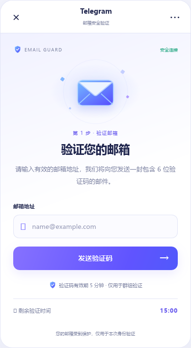
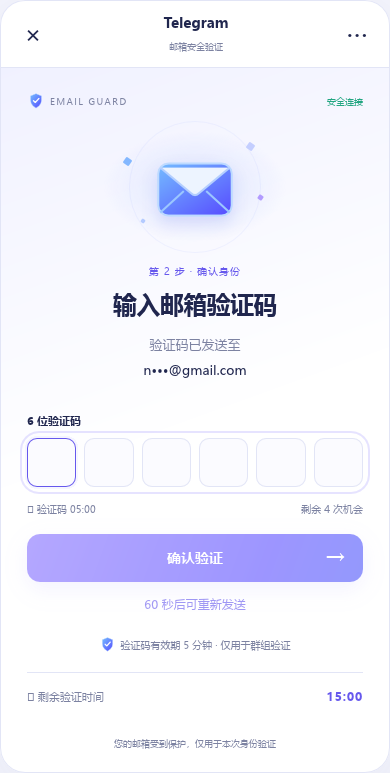
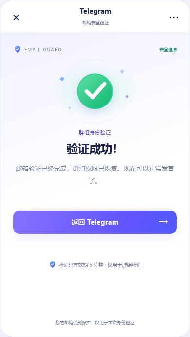
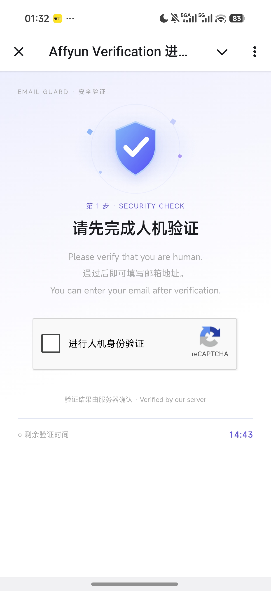
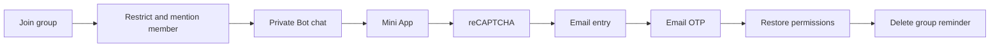

# Email Guard · Telegram Group Email Verification

[中文](README.md) · [English](README.en.md) · [Deployment](docs/deployment-server.md) · [Design gallery](docs/design/README.md)

**Verify new members with reCAPTCHA and email OTP inside Telegram, then restore group permissions.**

A Telegram supergroup Bot + Mini App built with React, TypeScript, CSS and SVG. Includes blue-purple visuals, light/dark themes, Resend email delivery, Google reCAPTCHA v2 and automatic per-member reminder cleanup.

<table>
<tr><th>Email entry</th><th>Email OTP</th><th>Verification complete</th></tr>
<tr>
<td></td>
<td></td>
<td></td>
</tr>
</table>

These are browser renders of the actual UI components. The following screenshot shows the reCAPTCHA gate running in a real Telegram mobile client. See the [gallery](docs/design/README.md) for screenshot provenance.

<details>
<summary>Live reCAPTCHA gate in Telegram</summary>
<br>

</details>

## Features

| Feature | Behavior |
|---|---|
| Onboarding | Mention the exact new member by Telegram ID; bilingual welcome and private-chat deep link |
| Human verification | Google reCAPTCHA v2 before email entry; server checks hostname, age and token reuse |
| Email OTP | Resend delivery, six-digit codes, resend cooldown and attempt/send limits |
| Group permissions | Restrict new members; restore group defaults after verification with background retries |
| Reminder cleanup | Delete the tracked group reminder after success, final failure or total timeout |
| UI states | Seven Widget design states and fifteen Mini App states, plus the reCAPTCHA gate |
| Administration | Bot commands and APIs; both configured IDs and live group-admin status are checked |
| Themes | Telegram light/dark themes with shared icons, cards, buttons and feedback |

## Flow



Defaults: 15-minute total deadline, 5-minute OTP lifetime, 60-second resend cooldown, five wrong attempts and five sends per session. Limits are enforced by the backend.

## Validation and limitations

- The owner completed the real join → email delivery → OTP → permission-restoration flow with a regular account. reCAPTCHA was also tested successfully in Telegram on 2026-11-17.
- 25 automated tests and the TypeScript/Vite build pass.
- Telegram rejects native `sendWidget` for the current Bot with `INPUT_MEDIA_WIDGET_NOT_ALLOWED`. Production falls back to a **branded guide image and an official `web_app` button**. Native templates and the preferred native-send path remain in the source. Widget browser screenshots do not demonstrate native Telegram availability.
- Documentation, welcome text and selected guidance are bilingual. Full Mini App language switching is not implemented.
- Durable outbox processing, comprehensive business auditing, retention cleanup and large-scale failure testing remain on the roadmap. See [development status](docs/DEVELOPMENT_STATUS.md).

## Run locally

Use Node.js 24 and npm. Demo mode requires no real Bot, mail provider or database.

```sh
npm ci
```

Terminal 1 (PowerShell):

```powershell
$env:DEMO_MODE='true'
$env:NODE_ENV='development'
npm run api
```

On macOS/Linux: `DEMO_MODE=true NODE_ENV=development npm run api`.

Terminal 2:

```sh
npm run dev -- --configLoader runner
```

| URL | Purpose |
|---|---|
| http://127.0.0.1:5173/?demo=1 | Interactive local demo; OTP: `246810` |
| http://127.0.0.1:5173/?view=gallery | All component design states |
| http://127.0.0.1:5173/?view=mini-OTP&theme=dark | Dark OTP snapshot |

Demo mode sends no real email and changes no Telegram permissions. The gallery is a visual review tool. Production entry requires valid Telegram `initData` and an existing owned session.

## Deploy and verify

Copy `.env.example` to `.env`, configure Telegram, Resend, PostgreSQL, an HTTPS domain and reCAPTCHA, then follow the [bilingual deployment guide](docs/deployment-server.md). Secret keys stay on the server; only the public reCAPTCHA Site Key reaches the browser.

```sh
npm test
npm run build
```

GitHub Actions runs tests and builds on pushes and pull requests. Screenshot scripts use Moli CDP; see the [gallery](docs/design/README.md).

## Repository map

```text
src/                 React Mini App, shared states, SVG icons and styles
server/              Fastify API, Telegram, email, CAPTCHA, admin and jobs
db/                  PostgreSQL startup migration
public/              Standalone Widget and bilingual guide image
deploy/              Prebuilt Docker and Nginx configuration
scripts/             Demo API checks, screenshots and design exports
tests/               Security, OTP, CAPTCHA and message-cleanup tests
docs/                Architecture, deployment, validation and gallery
```

## Documentation

- [Architecture & API](docs/ARCHITECTURE.md)
- [Deployment](docs/deployment-server.md)
- [Design gallery](docs/design/README.md)
- [State flow](docs/design/state-flow.md)
- [reCAPTCHA setup](docs/RECAPTCHA.md)
- [Validation & roadmap](docs/DEVELOPMENT_STATUS.md)
- [Security](SECURITY.md)

Production tokens, private keys, database backups and personal email test records are excluded from this repository.
