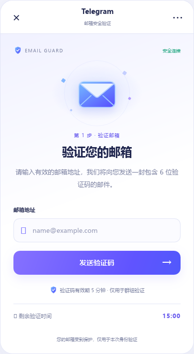
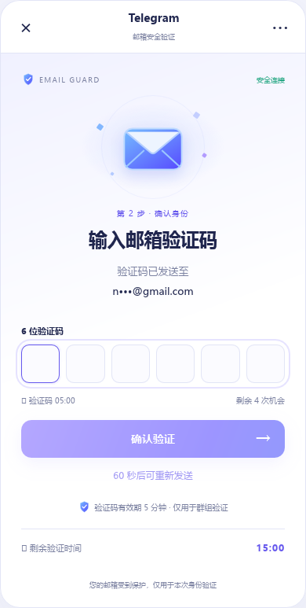
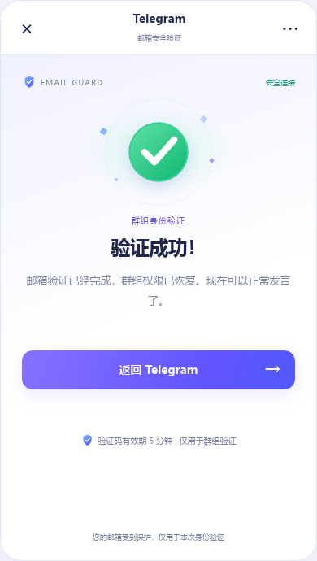
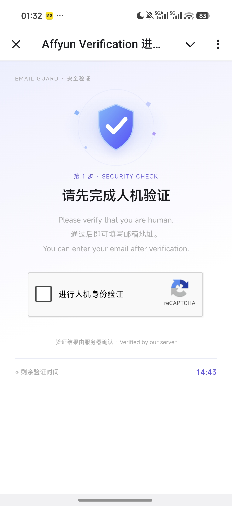
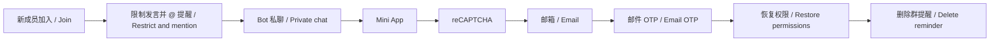

# Email Guard · Telegram 群组邮箱验证

[中文](README.md) · [English](README.en.md) · [部署 / Deployment](docs/deployment-server.md) · [设计 / Design](docs/design/README.md)

**让新成员在 Telegram 内完成人机验证和邮箱验证，再恢复群组发言权限。**

面向 Telegram 超级群的 Bot + Mini App，提供蓝紫色视觉、深浅主题、邮箱 OTP、Google reCAPTCHA v2，以及按成员追踪的入群提醒清理。界面使用 React、CSS 与 SVG 实现。

<table>
<tr><th>邮箱输入 · Email</th><th>验证码 · OTP</th><th>成功 · Success</th></tr>
<tr>
<td></td>
<td></td>
<td></td>
</tr>
</table>

> 上图为实际组件的浏览器渲染。以下为 Telegram 手机客户端中的真实 reCAPTCHA 页面；项目所有截图的来源与验证范围见[设计图册](docs/design/README.md)。

<details>
<summary>查看 Telegram 内的人机验证 · reCAPTCHA in Telegram</summary>
<br>

</details>

## 功能

| 功能 | 实现 |
|---|---|
| 入群引导 | 按 Telegram 用户 ID @ 新成员，中英文欢迎文案，单次深链进入 Bot 私聊 |
| 人机验证 | 邮箱输入前展示 Google reCAPTCHA v2，服务端验证域名、时间和单次 token |
| 邮箱 OTP | Resend 发信，六位验证码，重发冷却、错误次数与发送次数限制 |
| 群组权限 | 新成员限制发言；邮箱通过后恢复群默认权限，失败时后台重试 |
| 消息清理 | 验证成功、最终失败或总时限结束后，自动清理该成员的群提醒 |
| UI 状态 | 7 种 Widget 设计状态、15 种 Mini App 状态，额外提供人机验证前置页面 |
| 管理功能 | 管理员命令与 API，同时校验配置 ID 和真实群管理员身份 |
| 界面主题 | Telegram 浅色与深色主题，统一图标、卡片、按钮和反馈 |

## 验证流程



默认参数：总时限 15 分钟、验证码有效期 5 分钟、重发冷却 60 秒、最多 5 次错误及 5 次发信。参数由后端配置控制。

## 已验证与限制

- 已部署并由普通账号完成真实入群、邮件投递、OTP 与权限恢复测试；reCAPTCHA 亦由项目所有者在 Telegram 内确认测试通过（2026-11-17）。
- 当前 27 项自动测试通过，TypeScript 与 Vite 构建通过。
- 当前 Bot 的原生 `sendWidget` 请求被 Telegram 拒绝，返回 `INPUT_MEDIA_WIDGET_NOT_ALLOWED`。生产使用**品牌引导图片 + 官方 `web_app` 按钮**，保留原生 Widget 模板与优先尝试路径。浏览器 Widget 截图不代表原生功能已获 Telegram 支持。
- 中英文覆盖项目文档、群欢迎文案及验证引导等部分界面；完整 Mini App 多语言切换尚未实现。
- outbox、完整业务审计、过期数据清理与大规模故障演练仍待完善。详见[开发状态](docs/DEVELOPMENT_STATUS.md)。

## 体验演示与部署准备

**演示入口：[Affyun 公开群](https://t.me/affyuncom)**。加入后按欢迎提示进入 Bot 私聊，体验人机验证、邮箱 OTP 和权限恢复。此为实际社区，请勿批量测试或发送垃圾内容。

部署需准备 **VPS、域名与 DNS、Telegram Bot 和超级群、Resend 邮件服务、Google reCAPTCHA v2**。PostgreSQL 随 Compose 启动。

- [完整部署准备清单](docs/PREREQUISITES.md)：服务器建议配置、账户、密钥、权限、网络和服务费用说明。
- [AI Agent 一键部署与引导](docs/AI_AGENT_DEPLOY.md)：可复制任务提示词、自动配置检查、测试构建、Webhook 与菜单设置。

```sh
npm ci
npm run deploy -- --init   # 首次生成配置，然后填写服务商信息
npm run deploy -- --check
npm run deploy -- --deploy --mode dedicated
```

已有 Nginx 使用 nginx 模式；账户注册、DNS 所有权验证和真人挑战由您配合完成。详细步骤见 Agent 指南。


## 本地运行

需要 Node.js 24 与 npm。演示模式无需真实 Bot、邮件或数据库配置。

```sh
npm ci
```

终端一（PowerShell）：

```powershell
$env:DEMO_MODE='true'
$env:NODE_ENV='development'
npm run api
```

macOS / Linux 使用 `DEMO_MODE=true NODE_ENV=development npm run api`。

终端二：

```sh
npm run dev -- --configLoader runner
```

| 地址 | 用途 |
|---|---|
| http://127.0.0.1:5173/?demo=1 | 可操作的本地演示，验证码 `246810` |
| http://127.0.0.1:5173/?view=gallery | 全部组件设计状态 |
| http://127.0.0.1:5173/?view=mini-OTP&theme=dark | 深色 OTP 状态 |

演示不会发送真实邮件或修改 Telegram 权限；设计图册仅供视觉检查。生产根页面要求有效 Telegram `initData` 和已建立的会话，不是匿名公开表单。

## 部署与配置

复制 `.env.example` 为 `.env`，配置 Telegram、Resend、PostgreSQL、HTTPS 域名与 reCAPTCHA，然后按[双语部署指南](docs/deployment-server.md)运行。生产密钥仅保存在服务端，前端只接收公开 Site Key。

```sh
npm test
npm run build
```

GitHub Actions 对推送和 Pull Request 执行测试与构建。截图脚本使用 Moli CDP，参见[设计图册](docs/design/README.md)。

## 项目结构

```text
src/                 React Mini App、状态组件、SVG、样式
server/              Fastify API、Telegram、邮件、reCAPTCHA、管理与后台任务
db/                  PostgreSQL 启动迁移
public/              Widget 独立模板与双语引导图片
deploy/              预构建 Docker 与 Nginx 配置
scripts/             演示 API 检查、截图与设计导出
tests/               安全、OTP、reCAPTCHA、消息清理测试
docs/                双语架构、部署、验收记录与设计图册
```

## 文档

- [English introduction](README.en.md)
- [架构与 API / Architecture & API](docs/ARCHITECTURE.md)
- [部署 / Deployment](docs/deployment-server.md)
- [设计图册 / Design gallery](docs/design/README.md)
- [状态流转 / State flow](docs/design/state-flow.md)
- [reCAPTCHA 配置 / reCAPTCHA setup](docs/RECAPTCHA.md)
- [验收与后续工作 / Validation & roadmap](docs/DEVELOPMENT_STATUS.md)
- [安全说明 / Security](SECURITY.md)

本仓库不包含生产 Token、私钥、数据库备份或个人测试邮件记录。
