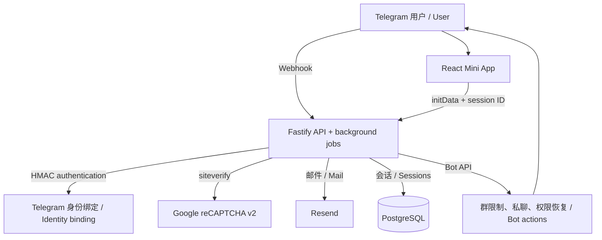

# 架构与 API · Architecture & API

## 系统结构 · System structure

前端不持有 Bot Token、Resend 密钥或 reCAPTCHA Secret。所有验证操作绑定服务器校验后的 Telegram 用户和会话。Google Site Key 是公开配置。

The frontend never receives the Bot Token, Resend key or reCAPTCHA Secret. Verification actions bind to the authenticated Telegram user and owned session. The Google Site Key is public configuration.

## 状态与数据 · State and storage

会话保存在 `verification_sessions.data` JSONB 中。生产更新采用 PostgreSQL 事务与会话行锁；OTP 哈希、计数、截止时间、待恢复权限和待删除提醒均由服务端持久化。前端以 `stateFromSession` 映射界面状态。

Sessions live in `verification_sessions.data` JSONB. Production updates use transactions and row locks. OTP hashes, counters, deadlines, pending permission changes and tracked reminders persist on the server. `stateFromSession` maps these to UI states.

| 表 / Table | 用途 / Purpose |
|---|---|
| verification_sessions | 用户/群组会话与重试状态 / Per-user/group sessions and retries |
| processed_updates | Webhook update ID 去重 / Webhook update deduplication |
| email_send_logs | 用户和邮件哈希发信限流 / User/email-hash sending limits |
| audit_logs | 部分验证及管理事件 / Selected verification and admin events |
| consumed_captcha_tokens | 已消费 reCAPTCHA token 的摘要 / Consumed CAPTCHA token digests |

邮箱原文保存在服务端会话，API 只返回掩码；数据库需要访问控制与备份保护。目前未实现自动数据保留期清理。

Raw email addresses are stored in server sessions; the API returns masked addresses. Protect the database and backups. Automatic retention cleanup is not implemented yet.

## 验证 API · Verification API

基础路径：`/api/verification`。请求使用 `X-Telegram-Init-Data`；建立会话后使用 `X-Session-Id`。POST 内容类型为 `application/json`。

Base path: `/api/verification`. Send raw `X-Telegram-Init-Data` and, after bootstrap, `X-Session-Id`. POST bodies are JSON.

| 方法 / Method | 路径 / Path | 请求 / Body | 行为 / Behavior |
|---|---|---|---|
| POST | /bootstrap | `{ "sessionId": "optional-session-uuid" }` | 查询本人已从私聊启动的会话 / Load owned session opened through private chat |
| GET | /session/status | — | 查询真实状态 / Retrieve current status |
| POST | /captcha/verify | `{ "token": "google-response" }` | 后端验证并记入会话 / Verify server-side and mark the session |
| POST | /email/send | `{ "email": "name@example.com" }` | 验证后发送 OTP / Send OTP after CAPTCHA |
| POST | /email/resend | `{}` | 受冷却与额度控制 / Resend within cooldown/quota rules |
| POST | /otp/verify | `{ "otp": "123456" }` | 校验后进入权限恢复阶段 / Validate and begin permission restoration |

成功响应为公开会话，包含 `status`、截止时间、剩余次数及可选 `captchaRequired` / `captchaSiteKey`。失败响应包含 `code` 和可选 `session`。客户端错误次数不决定服务端权限。

Successful responses contain the public session: status, deadlines, remaining quotas and optional CAPTCHA fields. Errors return `code` and optionally `session`. Client-side counters never determine permissions.

主要错误：`UNAUTHORIZED`、`AUTH_EXPIRED`、`CAPTCHA_REQUIRED`、`CAPTCHA_INVALID`、`CAPTCHA_UNAVAILABLE`、`INVALID_EMAIL`、`COOLDOWN`、`SEND_LIMIT`、`OTP_INVALID`、`OTP_EXPIRED`、`MAX_ATTEMPTS`、`EXPIRED`、`MAIL_UNAVAILABLE`。

## 管理与后台 · Administration and jobs

`/api/admin/*` 校验 Telegram 身份、配置中的管理员 ID 和实际群管理员身份。提供 stats/users/verifications 查询和用户 mute/unmute/verify/reset 操作。Bot 命令实现在 `server/telegram.ts`，业务操作在 `server/admin.ts`。

Admin endpoints validate Telegram identity, configured admin IDs and live group-admin status. They expose stats/users/verifications queries and mute/unmute/verify/reset actions. Bot commands live in `server/telegram.ts`; actions live in `server/admin.ts`.

后台重试处理权限恢复、最终限制及群提醒删除。欢迎消息只删除已保存 ID 的那条，不能批量删除历史未知消息。外部副作用尚未全部采用持久化 outbox，不能保证崩溃场景中的恰好一次执行。

Background jobs retry permission restoration, final restrictions and reminder deletion. Only the saved welcome-message ID is deleted. Historical untracked messages are not bulk-deleted. Not every external action uses a durable outbox; exactly-once behavior across crashes is not guaranteed.

## Widget 兼容 · Widget compatibility

`public/widget.html` 为内联模板，不含输入框、网络 API 或外部脚本。原生桥接请求由 Bot 处理。当前部署 Bot 无法发送原生 Widget，生产回退到 `public/guide.png` + 官方 `web_app` 按钮。该限制与 Mini App 本身可正常运行是两个独立事实。

The standalone Widget uses inline markup and no inputs, network APIs or external scripts. Bridge requests are handled by the Bot. The deployed Bot cannot send native Widgets, so production uses `public/guide.png` plus an official `web_app` button. The Mini App operates independently of this native Widget limitation.
