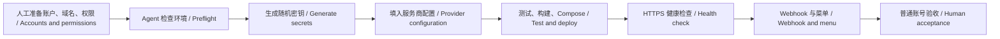

# 部署准备清单 · Deployment prerequisites

[中文首页](../README.md) · [English](../README.en.md) · [AI Agent 部署](AI_AGENT_DEPLOY.md)

## 准备哪些东西？ · What do I need?

| 项目 / Item | 需要准备 / What to prepare | 如何获得 / How to obtain |
|---|---|---|
| VPS / 云服务器 | Ubuntu 24.04 推荐；建议 2 vCPU、2GB RAM、20GB SSD，公网 IP，SSH 权限 / Recommended starting size, public IP and SSH access | 任意可访问 Telegram、Google、Resend 的云服务商 / Any suitable VPS provider |
| 域名与 DNS | Mini App HTTPS 域名，如 verify.example.com；A 记录指向 VPS / A hostname pointing to the VPS | 自有域名，Cloudflare 等 DNS 服务 / Your domain and DNS provider |
| Telegram Bot | Bot Token、用户名 / Token and username | [BotFather](https://t.me/BotFather) 创建 / Create a Bot |
| Telegram 超级群 | 群数字 ID、管理员数字 ID；Bot 管理员权限 / Numeric IDs and Bot admin permissions | 将 Bot 加入群并授予限制成员、删除消息权限 / Add and promote the Bot |
| 邮件推送 | 当前适配器使用 Resend；API Key、已验证发信域名、发件地址 / Resend key, verified domain and sender | [Resend](https://resend.com/)，按控制台配置 DKIM/SPF 等 DNS / Follow provider DNS setup |
| Google reCAPTCHA | v2 “我不是机器人”复选框 Site Key + Secret Key / v2 checkbox keys | [管理台 / Admin console](https://www.google.com/recaptcha/admin/create)，登记 Mini App 域名 / Register the Mini App hostname |
| 运行环境 | Node.js 24、npm、Git、Docker Engine + Compose plugin / Required tooling | 在构建机及 VPS 安装相应工具 / Install on build host/server |
| HTTPS / 反向代理 | 独占服务器用 Caddy；已有 Nginx 用独立站点与证书 / Caddy or existing Nginx with TLS | 两种方式见[部署指南](deployment-server.md) / See deployment guide |
| 数据库 | PostgreSQL 17，密码与持久化空间 / Password and persistent storage | Compose 自动创建，无需另购托管服务 / Included in Compose |

建议规格是起步建议，不是性能保证。1GB VPS 可采用本地构建后上传方案，但内存更紧张；大群应按负载扩容。现有代码只内置 Resend 邮件适配器，更换服务商需要修改 `server/service.ts`。

Sizing is a starting recommendation, not a performance guarantee. A 1GB VPS can use locally built frontend assets, but has tighter memory limits. Scale for larger groups. Only Resend is currently integrated; other providers require an adapter change.

## 网络与费用 · Network and costs

- 开放服务器入站 TCP 80/443；SSH 仅对管理来源开放。数据库与 app 端口无需公开。 / Allow inbound 80/443; restrict SSH; keep app/database ports private.
- 允许服务器出站访问 Telegram Bot API、Resend、Google reCAPTCHA；用户设备也需要访问 Google 验证服务。 / Both server API access and client access to Google are required.
- VPS、域名、邮件额度与 reCAPTCHA 配额按各服务商当前政策计算；本项目不提供免费额度保证。 / Provider pricing and quotas apply; no free allowance is guaranteed here.
- 准备备份位置与运维联系人；数据库包含邮箱和 Telegram 用户信息。 / Prepare private backups and an operator contact.

## 可以自动完成什么？ · What can be automated?

账户注册、购买 VPS、域名所有权验证和真正的人机挑战需要您完成；Agent 可引导，并在授权环境中执行其余步骤。不要在公开 Issue 里填写密钥。

Account creation, purchases, domain ownership checks and real CAPTCHA challenges require human action. An authorized Agent can guide these and automate the remaining setup. Never post secrets in public issues.
