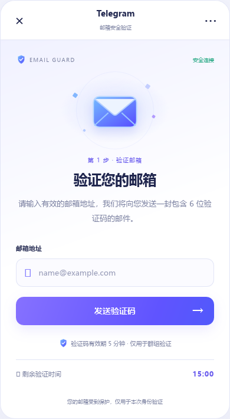
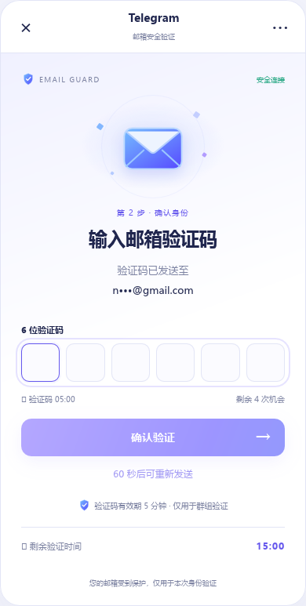
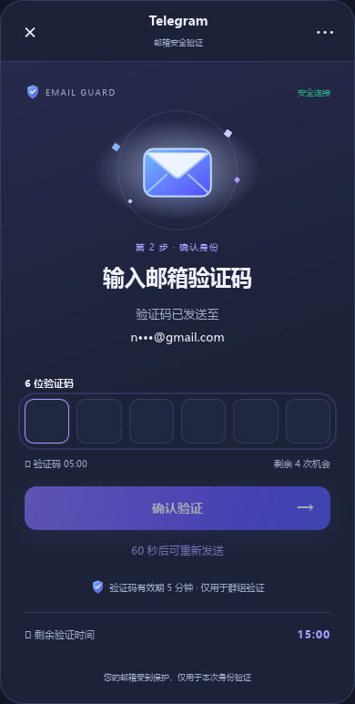
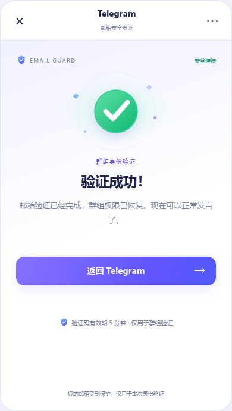
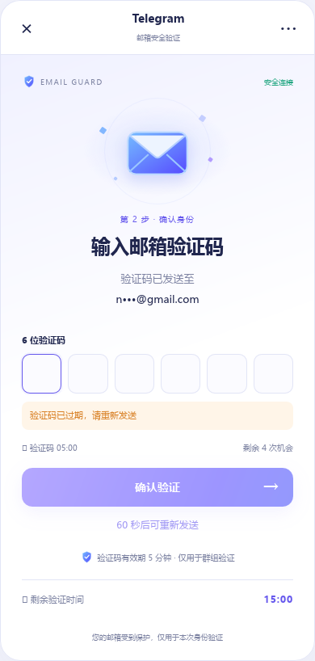
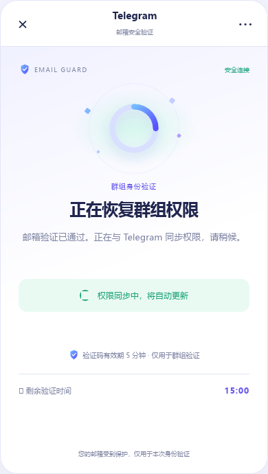
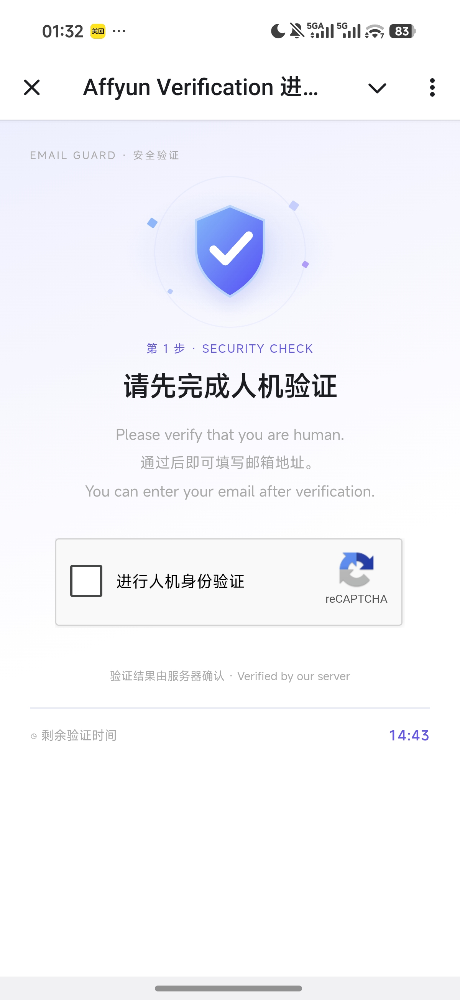
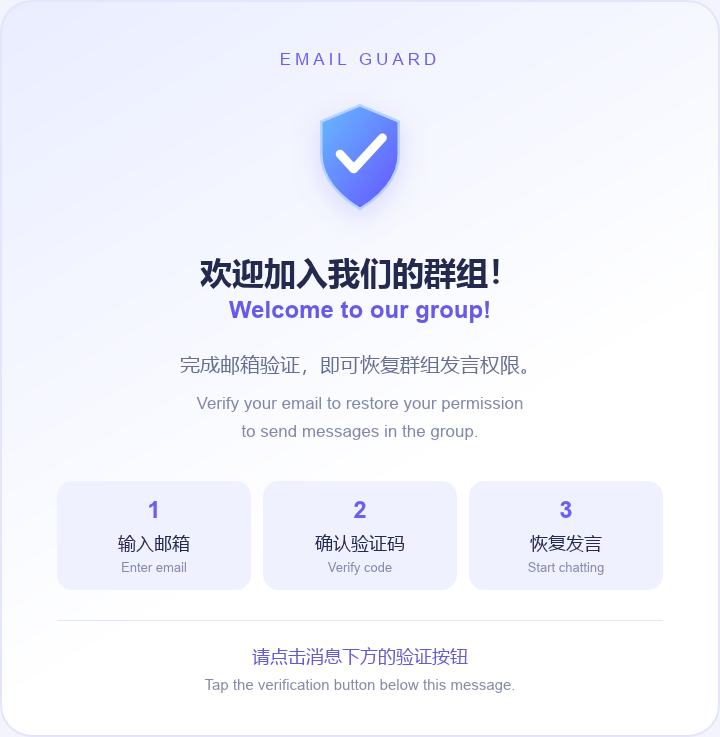
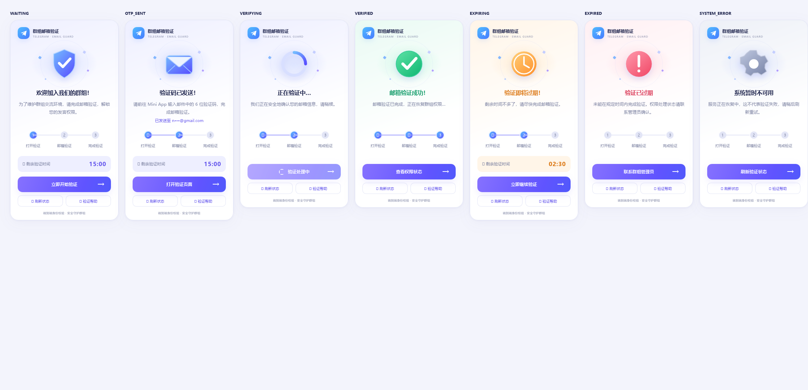

# 设计图册 · Design gallery

[中文首页](../../README.md) · [English](../../README.en.md)

## 主要界面 · Main screens

<table>
<tr><th>邮箱 / Email</th><th>验证码 / OTP</th><th>深色 / Dark</th></tr>
<tr>
<td></td>
<td></td>
<td></td>
</tr>
<tr><th>成功 / Success</th><th>过期 / Expired</th><th>恢复权限 / Restoring</th></tr>
<tr>
<td></td>
<td></td>
<td></td>
</tr>
</table>

## Telegram 真实界面 · Live Telegram screen



来源：项目所有者于 2026-11-17 提供的手机截图，并确认人机验证完成后流程正常。此截图未包含邮箱、用户数字 ID 或密钥。Google 挑战内容由第三方服务提供。

Source: mobile screenshot provided by the owner on 2026-11-17, along with confirmation that the CAPTCHA flow works. It contains no email address, numeric user ID or key. Google supplies the challenge content.

## 引导卡片 · Guide card



这是生产回退方案的静态品牌图片，真正的 `web_app` 按钮由 Bot 作为消息按钮发送。图片本身不包含可操作按钮，也不表示已发送原生 Widget。

This static branded image is the production fallback. The Bot sends a separate official `web_app` button. The image is not interactive and is not evidence of native Widget support.

## Widget 设计状态 · Widget design states



原生独立模板另见 `screenshots/sandbox-widget-*.png`。这些是浏览器桥接桩截图；当前 Bot 原生发送被 Telegram 拒绝。

Standalone template renders are in `screenshots/sandbox-widget-*.png`. They use browser bridge stubs; Telegram currently rejects native sends for the deployed Bot.

## 文件索引与来源 · Files and provenance

| 路径 / Path | 内容 / Content | 性质 / Provenance |
|---|---|---|
| screenshots/mini-*.png | 15 状态 × 2 主题 / 15 states × 2 themes | 真实组件的浏览器快照 / Browser renders of actual components |
| screenshots/widget-*.png | 7 状态 × 2 主题 / 7 states × 2 themes | React 设计组件 / React design components |
| screenshots/sandbox-widget-*.png | 7 状态 × 2 主题 / 7 states × 2 themes | 独立 HTML + 桥接桩 / Standalone HTML + stub |
| screenshots/interactive-success.png | 演示交互流程 / Interactive demo | 本地演示，无真实权限修改 / Local demo, no real permission changes |
| screenshots/production/recaptcha-telegram.jpg | 真实人机验证入口 / Live CAPTCHA entry | 所有者提供的 Telegram 手机截图 / Owner's Telegram mobile screenshot |
| overview.png | 完整状态总览 / Full overview | 浏览器 DOM 渲染 / Browser DOM render |
| widget-main.png / widget-states.png | 初始 Widget 设计稿 / Initial Widget designs | 实际组件渲染 / Actual component renders |
| miniapp-email.png / miniapp-otp.png / miniapp-success.png / miniapp-error.png | 初始页面设计稿 / Initial page designs | 实际组件渲染 / Actual component renders |

共 59 张历史浏览器截图，加 1 张真实 Telegram 截图。初始设计稿未包含后来加入的人机验证；以当前源代码和真实截图为准。

There are 59 historical browser screenshots plus one real Telegram screenshot. Initial design exports predate CAPTCHA; current source and the live screenshot take precedence.

## 规范与复现 · Specifications and reproduction

- [组件规范 / Component guidelines](ui-guidelines.md)
- [状态流转 / State flow](state-flow.md)
- [设计对照 / Design comparison](comparison.md)

运行本地 API 和 Vite 后，使用已安装的 Moli：

With the local API and Vite running, use an installed Moli runtime:

```sh
moli serve --layout --port 9222
npm run screenshots
npx tsx scripts/widget-check.ts
```

截图脚本连接本机 CDP 9222，不会下载浏览器。浏览器快照不能替代真实 Telegram 多客户端验收。

The scripts connect to local CDP port 9222 and do not download a browser. Browser snapshots do not replace real Telegram multi-client testing.
