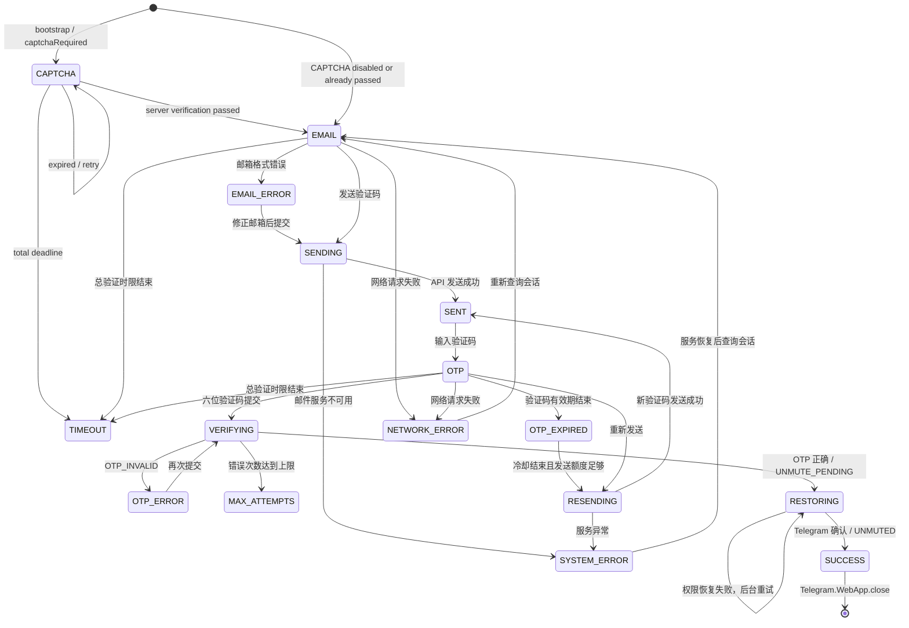

# 页面状态流转 · Page state flow

重试实际通过 `stateFromSession` 返回后端当前阶段，不固定返回邮箱页。超时和错误次数上限进入持久化权限处理；不得在 Telegram 未确认前宣称永久禁言或恢复发言成功。

|Widget 状态|Mini App / 业务状态|
|---|---|
|WAITING|EMAIL / WAITING_FOR_EMAIL|
|OTP_SENT|SENT、OTP、OTP_ERROR、OTP_EXPIRED、RESENDING|
|VERIFYING|VERIFYING|
|VERIFIED|RESTORING 或 SUCCESS，以真实权限状态显示不同文案|
|EXPIRING|总时限不足三分钟且未完成|
|EXPIRED|TIMEOUT 或 MAX_ATTEMPTS；联系管理员|
|SYSTEM_ERROR|NETWORK_ERROR 或 SYSTEM_ERROR；刷新重试|

## English notes

The CAPTCHA gate precedes email entry when enabled. Failed or expired challenges stay on the gate and can be retried. Email/OTP UI states share the same session model. Only UNMUTED maps to SUCCESS; pending or retrying permission restoration maps to RESTORING. OTP expiry does not add wrong attempts. Network/system retries retrieve the current server state, rather than resetting the flow. Widget states describe presentation; they do not prove native Widget availability.
